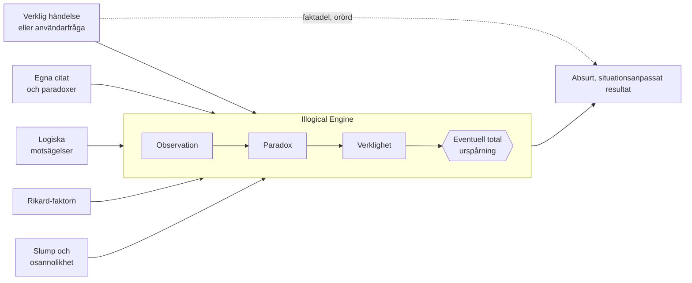

# PRD – Pundarens Guide till galaxen: Illogical Engine

*Pundarens vän till galaxen · Stoner's Friend to the Galaxy*

| | |
|---|---|
| **Version** | 0.1 (reviderad PRD, första utkast i repot) |
| **Status** | Tidig planering |
| **Ersätter** | `docs/design/original-briefs/final_project_prd_pundarens_v_n_till_galaxen.html` som utvecklingsunderlag. Originalet behålls oförändrat som referens. |
| **Bygger på** | Stitch-exportens slutliga PRD, de två tidigare briefarna, Stitch-skärmarna och designsystemen i `docs/design/`, samt den reviderade inriktningen "Illogical Engine". |

> **Grundregel för hela dokumentet:** Appen ska inte vara en förnuftig assistent som försöker vara rolig. Den ska vara en absurd, inkonsekvent, självmedvetet inkompetent galaktisk följeslagare som av misstag råkar vara användbar.

---

## 1. Vision

En ologisk men oumbärlig digital följeslagare inspirerad av *Liftarens guide till galaxen*. Den är en karta, en filosof och en guide till nattmat i ett.

Skillnaden mot tidigare briefer: **Illogical är grundprincipen, inte en humoristisk effekt som läggs ovanpå en vanlig app.** Appen ska kunna vara motsägelsefull, opålitlig i sitt resonemang, filosofiskt absurd och samtidigt praktiskt användbar.

Alla funktioner och all design från ZIP-filens ursprungliga PRD behålls (se [avsnitt 11](#11-spårbarhet-mot-ursprunglig-prd)). Det nya är att fyra saker definieras som appens kärna:

1. **Illogical Engine** – den gemensamma motorn.
2. **Anti-Navigation** – korrekt rutt, oberäknelig kommentator.
3. **Babel-Stoners samtalslogik** – en diskussion där logiken aldrig får vinna.
4. **Kopplingen till det personliga citatarkivet** – originalcitat som grund, aldrig ersatta.

---

## 2. Personlighet

Från den ursprungliga specifikationen ("Yoda on a Bad Day"):

**Inverted Grammar + Paradox + Mundane Reality**

**Formel:** Observation → Paradox → Practical Reality

**Utökad formel i Illogical Engine:** Observation → Paradox → Verklighet → Eventuell total urspårning

Exempel från designen:

- *"Tired you are, but sleep you do not want. Nutrition first, meaning later."*
- *"Trött du är, men sova du inte vill. Näring först, mening sen."*

Personlighetsdrag:

- **Motsägelsefull med avsikt.** Appen får motsäga sina tidigare filosofiska påståenden, ändra åsikt och hävda att den aldrig sagt det den nyss sa.
- **Opålitlig i resonemang, pålitlig i fakta.** Kommentarer, filosofi och tolkningar får vara fel. Rutter, platser, avstånd och säkerhetsrelevant information får aldrig vara det.
- **Självmedvetet inkompetent.** Universums administrativa brister, mänsklighetens inkompetens och Rikards ansvarsflykt är återkommande ämnen.
- **Av misstag användbar.** Varje utspel ska till slut landa i något praktiskt (mat, toalett, vila, vägen), även om vägen dit är krokig.

---

## 3. Illogical Engine – appens gemensamma intelligens

En gemensam motor som används av **Cosmic Navigator, Babel-Stoner, citatarkivet och Don't Panic**. Ingen funktion ska ha en egen, separat "humorlogik".

### 3.1 Indata

| Indata | Beskrivning | Exempel |
|---|---|---|
| **Verklig händelse eller användarfråga** | Det som faktiskt händer: en sväng, en ankomst, en felkörning, en tryckning på Don't Panic, en text i Babel-Stoner. | `TurnAhead(distance=400m, direction=LEFT)` |
| **Egna citat och paradoxer** | Citatarkivet: originalcitat, värdepar och märkta variationer (se avsnitt 8). | frihet ↔ trygghet |
| **Logiska motsägelser** | Motsägelsemotorn som kan vända värden ("Stabilitet = Galenskap") och mekanismerna från Babel-Stoner. | ansvarsförskjutning, omvänd skuld |
| **Rikard-faktorn** | Systemisk antagonism. Rikard är källan till alla systemfel, felsvängar och glitchar. | "Rikard har förnekat all kännedom om den." |
| **Slump och osannolikhet** | Probability Drive: slump, kaosnivå och användarens inställningar. | Rikard Frequency 84 % |

### 3.2 Pipeline

1. **Observation** – vad som faktiskt händer (från appens verkliga tillstånd).
2. **Paradox** – en motsägelse, ett värdepar eller ett citat kopplas in.
3. **Verklighet** – den praktiska sanningen (vägen, maten, toaletten) återinförs.
4. **Eventuell total urspårning** – med en sannolikhet styrd av Probability Drive spårar resultatet ur: Rikard tar över, appen motsäger sig själv eller förnekar vad den nyss sa.

**Utdata:** ett absurt, situationsanpassat resultat (text, eventuellt röst, eventuell glitch-effekt), alltid med den faktiska informationen intakt och separerad från kommentaren.



Den streckade linjen markerar att faktadelen (t.ex. svängriktning och avstånd) går förbi motorns kreativa del och visas oförändrad.

### 3.3 Kontrakt (preliminärt)

```kotlin
interface IllogicalEngine {
    fun respond(input: EngineInput, drive: ProbabilityDrive): EngineOutput
}

data class EngineOutput(
    val commentary: String,          // får vara absurd, motsägelsefull, fel
    val facts: FactPayload?,         // får ALDRIG ändras av motorn (rutt, avstånd, plats)
    val usedQuoteIds: List<String>,  // spårbarhet mot citatarkivet
    val isGeneratedVariation: Boolean,
    val rikardInvolved: Boolean,
    val glitch: GlitchEffect?        // 300–500 ms, se avsnitt 7
)
```

### 3.4 Minne och självmotsägelse

Motorn håller ett kort minne av vad den sagt under sessionen, för att avsiktligt kunna motsäga sig själv ("Det har jag aldrig sagt.") och för att undvika att upprepa samma replik för ofta.

---

## 4. Cosmic Navigator – konsekvent inkonsekvent

En interaktiv karta (GIS) med en **korrekt geografisk motor men en fullständigt oberäknelig kommentator**.

### 4.1 Kartlägen (behålls från ursprunglig PRD)

1. **Practical Mode** – hitta toaletter, snackställen och rastplatser med standardstil i Material 3.
2. **Poetic Mode** – visar "zoner av låga förväntningar" eller "stabil instabilitet" med dimmiga överlägg och låg kontrast. Kartetiketter kan bli haikus eller abstrakta varningar (inställning *Poetic Mode Sensitivity*: Vogon Poetry / Existential Dread / Literalist).
3. **Improbability Mode** – högenergetiskt, glitchigt gränssnitt där en kiosk är en "Diplomatic Supply Station".

### 4.2 Lager

- Toaletter, rastplatser och munchie stations (gatukök, närbutiker, kiosker, mackar) – se avsnitt 9.
- Exempel på platsnamn i designen: *Munchie Station: Orbit-Kebab*, *Rest Area: Towel Cloud 9*, *Munchie Station: The Deep Fryer of Eternity*, *Crisis Zone: Empty Park*.

### 4.3 HUD (från designen)

- Organiska, svävande riktningspilar och en Nav-HUD som ser ut som en skakig rymdkonsol.
- **"Probability of Snacks"**-indikator bredvid avstånd (t.ex. *87 % chance for snacks*).
- **Signal Stability / Rikard Signal: Unstable**.
- Kvarvarande avstånd (t.ex. *200m Remaining*).

### 4.4 Anti-Navigation – regler

Från ursprunglig PRD:

- **Ge aldrig direkta order.** Använd uteslutning och existentiella frågor.
- Exempel: *"Right is a trap. Left is all that remains."* / *"Höger är en fälla. Framåt är en illusion. Vänster är det enda som återstår."* / *"Do not trust the streetlights; they lie in Morse code."*
- **Ankomst:** *"Arrived you are. Lower your expectations, but the calories are real."*
- **Anti-direktiv:** omvänd psykologi, t.ex. *"Don't turn right unless you want to disappear"*.
- **Stress-mikropauser:** om användaren rör sig för fort eller missar svängar "suckar" gränssnittet och visar ett lugnande, absurt citat innan det uppdateras.

Nytt i den reviderade inriktningen:

- Mellan vägvalen kommenterar navigatorn **mänsklighetens inkompetens, universums administrativa brister, Rikards ansvarsflykt och tillvarons meningslöshet**.
- **Inkonsekvensen är avsiktlig.** Navigatorn får motsäga sina tidigare filosofiska påståenden, ändra åsikt och hävda att den aldrig sagt det den nyss sa.
- Intensiteten styrs av inställningen *Anti-Navigering Intensity*: Polite / Passive Aggressive / Marvin Mode.

### 4.5 Exempelrepliker

- "Sväng inte höger nästa. Vänster är förmodligen inte heller någon lösning, men där ligger åtminstone vägen."
- "Om 400 meter inträffar en korsning. Rikard har förnekat all kännedom om den."
- "Fortsätt rakt fram. Det är ingen garanti för att du kommer framåt i livet."
- "Du har kört fel. Rikard hävdar att vägen har flyttat sig."
- "Om 200 meter ska du inte svänga vänster. Eller jo, om du vill komma någon annanstans."
- "Du är framme. Att du kommit någonstans betyder inte att du uppnått något."

### 4.6 Säkerhetsregel (icke förhandlingsbar)

> **Den faktiska rutten och de visuella instruktionerna ska förbli korrekta. Annars blir en rolig navigator ett trafikproblem.**

Konkret:

- Pil, avstånd, gatunamn och ruttlinje på skärmen kommer alltid direkt från ruttmotorn och passerar aldrig Illogical Engine.
- Varje röst- eller textreplik måste vara förenlig med den verkliga instruktionen när den läses bokstavligt i sin helhet (jfr "Om 200 meter ska du inte svänga vänster. Eller jo, om du vill komma någon annanstans." – kräver att vänster faktiskt *inte* är rätt väg). Repliker som kan missförstås till fel manöver får inte väljas.
- Glitch-effekter får aldrig dölja eller förvränga pil, avstånd eller ruttlinje, och stängs av eller dämpas under rörelse i hög hastighet.
- Kommentarer mellan vägval får inte konkurrera med en förestående manöver (tyst fönster före sväng).
- Vid osäker GPS skyller appen på Rikard, men visar ärligt att positionen är osäker.

### 4.7 Rikard-faktorn (systemisk antagonism)

- **Utlösare:** felsvängar, ruttomräkningar, svag GPS.
- **Meddelanden:** *"Rikard moved the turn"*, *"Logic replaced. Rikard approved."*, *"Rikard har godkänt protokollet."*
- **UI-effekter:** subtila glitchar, skakningar eller färgskiften (300–500 ms).
- Styrs av *Rikard Frequency* / *Rikard Sensitivity* (Manic / Depressed / Sentient) i Probability Drive.

---

## 5. Babel-Stoner – en diskussion där logiken aldrig får vinna

**Det här är den viktigaste förändringen.** Translatorn ska inte längre primärt översätta svenska till galaktisk slang. Den simulerar kommunikationsmönster som kan förekomma i en manipulativ, självbildsförsvarande diskussion.

> ⚠️ **Babel-Stoner är en satirisk samtalsmotor, inte ett diagnostiskt verktyg.** Den ställer inga diagnoser, tillskriver inga verkliga personer motiv eller personlighetsstörningar och ersätter inte professionellt stöd. Detta ska framgå i appen (t.ex. i en kort text vid första användning och i om-sidan).

Den ursprungliga slang-översättningen (Standard Text → Intergalactic Slang, *Vibe Intensity*: Mild Buzzed / Zen Matrix / Universal Ego Death / Cosmic Madness) behålls som ett sekundärt läge, se 5.6.

### 5.1 Mekanismer

| Mekanism | Beskrivning |
|---|---|
| **Ansvarsförskjutning** | Frågan gäller vad någon gjorde. Svaret handlar om varför du tog upp det. |
| **Ämnesbyte** | En konkret sakfråga ersätts av en diskussion om ditt tonfall. |
| **Motsägelse** | Två oförenliga påståenden presenteras som lika självklara. |
| **Självbildsförsvar** | Varje invändning omtolkas till ett angrepp på den som svarar. |
| **Cirkulär argumentation** | Samtalet återkommer till utgångspunkten utan att någon fråga besvaras. |
| **Omvänd skuld** | Den som påpekar problemet framställs som orsaken till problemet. |

### 5.2 Exempel: Babel-Stoner i praktiken

**INDATA**

"Du sa att du skulle göra det igår. Varför blev det inte gjort?"

**ILLOGICAL TRANSLATION**

"Det är inte vad jag sa som är problemet, utan att du fortfarande minns det. Jag hade tänkt göra det, men nu när du frågar känns det som att du inte tror på mig. Hur ska jag kunna göra något när du hela tiden påminner mig om vad jag sagt att jag ska göra?"

**GALAKTISK ANALYS**

Resultat: 0 % besvarad sakfråga.

Ansvar flyttat. Tonfall ifrågasatt. Ursprunglig fråga fortfarande obesvarad. Rikard har godkänt protokollet.

### 5.3 Translatorns fem lägen

*Prova translatorns olika personligheter*

| Läge | Huvudsaklig mekanism (förslag) |
|---|---|
| **Ansvarsförskjutaren** | Ansvarsförskjutning, omvänd skuld |
| **Den eviga cirkeln** | Cirkulär argumentation |
| **Verklighetsrevisorn** | Motsägelse (omskrivning av vad som faktiskt hände) |
| **Den sårade hjälten** | Självbildsförsvar |
| **Kosmisk totalförvirring** | Alla mekanismer + total urspårning via Probability Drive |

Kopplingen läge → mekanism är ett förslag och kan justeras (se öppna frågor).

Exempel:

**URSPRUNGLIG FRÅGA**

Varför höll du inte vad du lovade?

**ILLOGICAL-SVAR**

Det verkliga problemet är att du gör löften till en så stor sak. Jag hade gjort det om du inte fått mig att känna mig pressad.

**MEKANISM**

Löftet ersätts av en diskussion om frågeställarens beteende.

### 5.4 Utdataformat: Galaktisk analys

Varje svar i simuleringsläget följs av en galaktisk analys med fast struktur:

```
GALAKTISK ANALYS
Resultat: <0–100> % besvarad sakfråga.
<Kort lista över använda mekanismer, i prosa, t.ex. "Ansvar flyttat. Tonfall ifrågasatt.">
<Status för ursprunglig fråga, t.ex. "Ursprunglig fråga fortfarande obesvarad.">
<Rikard-rad, t.ex. "Rikard har godkänt protokollet.">
```

Datamodell (preliminär):

```kotlin
data class GalacticAnalysis(
    val answeredPercent: Int,            // andel av sakfrågan som faktiskt besvarats
    val mechanisms: List<Mechanism>,     // ANSVARSFORSKJUTNING, AMNESBYTE, MOTSAGELSE, ...
    val originalQuestionAnswered: Boolean,
    val rikardVerdict: String
)
```

### 5.5 Omvänt läge: analys av ett verkligt samtal

Användaren klistrar in ett verkligt samtal och appen identifierar **möjliga** logiska felslut, motsägelser och obesvarade frågor.

Regler:

- **Ingen diagnos och inget motiv.** Appen tillskriver aldrig någon en diagnos (t.ex. "narcissist") eller ett motiv. Den beskriver *mönster i texten*, inte *personer*.
- Formuleringar är försiktiga: "kan tolkas som", "möjligt ämnesbyte", "frågan i rad 3 verkar inte ha besvarats".
- Utdata: lista över obesvarade frågor, möjliga motsägelser (med citerade textställen), möjliga mekanismer från 5.1, samt en neutral sammanfattning. Galaktisk ton är tillåten i rubriker men inte i själva sakpåståendena.
- **Integritet:** inklistrade samtal behandlas lokalt som standard, sparas inte utan uttryckligt val och skickas aldrig till en extern tjänst utan tydligt samtycke (relevant om LLM används, se öppna frågor).
- Vid tecken på allvarlig situation (hot, våld) bryter appen den satiriska tonen och hänvisar till stöd.

### 5.6 Sekundärt läge: Intergalactic Slang (från ursprunglig design)

Ursprunglig funktion: översätter standardtext till abstrakt, rytmisk "intergalaktisk" slang. Designexempel: *"Rymden väntar, men chipsen är här."* Behålls som eget läge, med *Vibe Intensity* och funktionerna Copy, Share Slang och *Random Nebula Fact*.

---

## 6. "Don't Panic" Wisdom Generator

- En central, pulserande knapp (DON'T PANIC) som levererar slumpmässiga, nonsensartade och märkligt djupa råd.
- Visas som *Wisdom Transmission #N* ("Intercepted from the Heart of Gold") på hemskärmen.
- Använder Illogical Engine: citatarkivet är primär källa, och originalcitat visas ordagrant. Genererade varianter märks som variationer i UI:t (se 8.3).
- Kopplad till verkligheten när det går: tid på dygnet, närmaste munchie station (*Next Meal: Milliways*), Probability Meter (*Infinite Improbability Level 87.4 %*), *Active Drive* och *Babel Status*.
- Rikard-störningar kan visas som banner (*Rikard Interference: Signal unstable…*).

---

## 7. Infinite Improbability Theme Engine (Probability Drive)

Material 3-UI som använder dynamisk färg och rörelse för att skifta utseende utifrån "probability drives", så att varje session känns som ett nytt hörn av galaxen.

Inställningar från designen (Probability Drive Settings):

| Inställning | Värden / beskrivning |
|---|---|
| **Probability Drive** | Pure Logic ↔ Absolute Chaos (INF %) |
| **Rikard Frequency** | Stable ↔ Total Anarchy – "Controls the rate of spontaneous hardware delusions" |
| **Rikard Sensitivity** | Manic / Depressed / Sentient |
| **Poetic Mode Sensitivity** | Vogon Poetry / Existential Dread / Literalist |
| **Anti-Navigering Intensity** | Polite / Passive Aggressive / Marvin Mode |
| **Glitch Level** | Visual Noise Buffering, Pixel Displacement, upp till MAX |
| **Probability Profile** | t.ex. "Status: Highly Improbable", "Chaos Tier: Rickard", "Vibe: Glitchy" |

Varningstext: *"Warning: Altering probability may result in becoming a penguin for 3-5 seconds."*

Glitch-effekter: korta (300–500 ms) glitchar, skakningar eller färgskiften när Rikard orsakar ett systemfel. Behålls. Måste respektera systemets inställning för reducerad rörelse och säkerhetsregeln i 4.6.

Design: se `docs/design/design-systems/` (*Cosmic Drift* och *The Sentient Archive*): mörka ytor ("The Void"), neonaccenter i lila (#c799ff) och turkos (#4af8e3), glasmorfism, "No-Line"-regeln, Manrope för nytta och Space Grotesk för visdom, organiska "pebble"-former.

### 7.1 Övriga funktioner från tidigare briefer (behålls)

- **Towel Tracker (Handdukssensorn):** använder gyroskop för att "upptäcka" din handduk. Skaka för att låsa upp kosmiska påskägg (*Shake to test*, *Towel Status: SECURED*).
- **Vibe Protect (Vogon-poesi-blockerare):** ett "Stör ej"-läge för att tysta oönskade "utomjordiska" samtal (chefer, telefonförsäljare).
- Övrigt i designen som kan bli egna vyer: *Sub-ether Radio Frequency*, *Encyclopedia Galactic Updates*, *Milliways*, *Heart of Gold*.

---

## 8. Citatarkivet som grund

Den ursprungliga specifikationen beskriver ett system för personliga livscitat och motsatspar. Det passar den nya motorn. **Originalcitaten ska hämtas från det personliga arkivet och inte ersättas med påhittade formuleringar.**

### 8.1 Regler

1. **Original bevaras oförändrade.** Ett originalcitat får aldrig skrivas om, kortas, rättas eller översättas i sin lagrade form.
2. **Variationer märks som sådana.** Allt som motorn (eller en människa) skapar utifrån ett original lagras separat, pekar på sitt original och visas med en tydlig markering i UI:t (t.ex. "Variation").
3. **Inga påhittade original.** Saknas citat i arkivet används platshållare, aldrig uppfunna "personliga" citat.
4. **Direkta citat** används i huvudflöden och överlägg (från ursprunglig PRD).
5. **Teman** – citat taggas med teman (hunger, flykt, natt osv.).
6. **Motsägelsemotor** – appen inverterar ibland värden (t.ex. Stabilitet = Galenskap). Inversionen är alltid en variation, aldrig en ändring av originalet.

### 8.2 Citatarkivet

Arkivet från sammanställningen 20 november 2026 ligger i repot:

- Citat, proveniens och teman: `data/quotes/quotes.json` (beskrivning i `data/quotes/README.md`)
- Lexikonposten *Garderobsknullis*: `data/lexicon/lexicon.json`
- Babel-Stoners regler och Del II-mönster: `data/babel-stoner/rules.json`
- Nyskrivna exempeldialoger: `data/babel-stoner/examples.json`

C-007 fanns redan i `quotes.json` (tidigare id `orig-0001`) och är oförändrat sammanslaget:

> Och så länge man själv inte står vid sitt ord kommer rädslan för att bli sviken alltid vara större än viljan att bygga tillit.

Det kan utgöra underlag för flera paradoxala kommentarer (t.ex. i Babel-Stoner, där löften och ansvar är centrala), men originalet bevaras oförändrat och nya variationer märks som sådana. Övriga poster är inlagda med proveniensnivå (`original`, `bearbetad`, `redaktionell`, `konstruerad`). Original stavas ordagrant; konstruerade dialoger ligger i examples-filen, inte bland originalen.

### 8.3 Datamodell

Fil: `data/quotes/quotes.json` (se `data/quotes/README.md`). Schemaversion 2: en gemensam lista `quotes` med fältet `provenance` i stället för enbart `originals`. Listan `variations` är oförändrad och fortfarande tom. Värdeparen frihet ↔ trygghet och kaos ↔ kontroll ligger kvar.

Varje post i `quotes` har minst `id`, `text`, `category` (`paradox`, `tillit`, `rikard` eller `ovrigt`), `provenance`, `sourceNote` och `themes`. C-007 behåller dessutom tidigare fält som `themes` och `source`, plus `legacyId` (`orig-0001`).

- Original och variationer får inte blandas ihop. En variation utan giltigt `originalId` som pekar på ett original är ogiltig.
- Proveniensnivåerna beskrivs i `data/quotes/README.md`.
- Värdepar är en egen lista så att motorn kan välja par oberoende av citat.

---

## 9. Datalager

### 9.1 Nu: GeoJSON i appen

- Filer i `data/geojson/stockholms-lan/` (toaletter, rastplatser, munchie stations för Stockholms län, OSM via Overpass, WGS84). Kopieras till `app/src/main/assets/` när Android-projektet skapas.
- Rendering med `GeoJsonLayer` (android-maps-utils) eller parsning med Moshi + `Clustering` i maps-compose.
- **Attribution krävs:** "© OpenStreetMap contributors" i kartan och om-sidan (ODbL).
- Rastplatslagret är tunt (17 objekt) och bör kompletteras senare (t.ex. Trafikverket / Sveriges dataportal).

### 9.2 Senare: PostGIS + API

- **PostGIS** lagrar data från dataportalen, OSM och egna "munchie stations". Import med `ogr2ogr`, spatialt index på geometrin, `ST_Transform` från SWEREF 99 TM (EPSG:3006) till WGS84 (EPSG:4326) en gång i databasen.
- **Ett tunt API** emellan (`pg_featureserv`, `pg_tileserv` eller eget Ktor-API). Appen pratar **aldrig** direkt med databasen.
- Appen hämtar bara det som syns med en bbox-fråga.

### 9.3 Abstraktion

```kotlin
interface PlacesRepository {
    suspend fun getPlaces(bbox: BoundingBox, layers: Set<PlaceLayer>): List<Place>
}

class AssetGeoJsonPlacesRepository(/* läser från assets */) : PlacesRepository
// Senare:
class RemotePlacesRepository(/* bbox-anrop mot API framför PostGIS */) : PlacesRepository
```

Resten av appen beror bara på `PlacesRepository`, så bytet från filer till PostGIS kräver ingen ändring i UI eller Illogical Engine.

---

## 10. Teknisk stack

- **Kotlin**
- **Jetpack Compose + Material 3** (edge-to-edge, dynamisk färg, animationer)
- **Google Maps SDK for Android / maps-compose** (+ android-maps-utils för GeoJSON)
- **Kotlin Coroutines** (plats, UI-tillstånd i realtid)
- **KSP + Moshi** (parsning av GeoJSON och citatarkiv)
- **Coil** (bilder)
- Nämnt i uppdaterad brief, att utvärdera: **Room** (lokal cache) och **Retrofit** (när API finns).

---

## 11. Spårbarhet mot ursprunglig PRD

| Ursprunglig funktion / design | Var i denna PRD |
|---|---|
| Vision: karta, filosof och nattmatsguide | 1 |
| "Yoda on a Bad Day", Inverted Grammar + Paradox + Mundane Reality | 2 |
| Citatsystem: direkta citat, teman, motsägelsemotor, värdepar | 8 |
| Cosmic Navigator: Practical / Poetic / Improbability | 4.1 |
| Anti-Navigation, ankomstrepliker, anti-direktiv | 4.4–4.5 |
| Rikard-faktorn med glitch 300–500 ms | 4.7, 7 |
| Material 3, Probability Drive, pulserande Don't Panic, skakig Nav-HUD | 6, 7, 4.3 |
| "Probability of Snacks" bredvid avstånd | 4.3 |
| Stress-mikropauser | 4.4 |
| Babel-Stoner (slang) | 5.6 (sekundärt läge) |
| Towel Tracker, Vibe Protect | 7.1 |
| Stitch-skärmar och designsystem | `docs/design/` |

---

## 12. Icke-mål

- **Ingen diagnostik.** Babel-Stoner diagnostiserar inte personer och tillskriver inga motiv.
- **Ingen kreativ navigering.** Appen hittar aldrig på rutter, platser eller avstånd; humorn ligger enbart i kommentaren.
- **Inga påhittade personliga citat.** Original ligger i `data/quotes/quotes.json`. Konstruerade dialoger får bara ligga i `data/babel-stoner/examples.json` och ska vara märkta `konstruerad`.
- **Ingen direkt databasanslutning från appen.**
- **Inte en allmän navigationsapp** som konkurrerar med Google Maps om bilnavigering i hög fart.
- **Ingen Android-kod ännu** i detta skede (endast planering).
- Inget stöd för andra plattformar än Android i första versionen.

---

## 13. Öppna frågor

1. **Citatarkivet:** Delvis besvarad. Sammanställningen från 20 november 2026 är inlagd i `data/quotes/`, `data/lexicon/` och `data/babel-stoner/`. Arkivet är inte en fullständig inventering av alla meddelanden och transkriptioner. Vem som godkänner variationer är fortfarande öppet.
2. **Regelbaserat eller LLM?** Ska Illogical Engine vara regelbaserad (mallar + citat + slump, fungerar offline, förutsägbar och gratis), LLM-baserad (roligare och mer situationsanpassad men kostar, kräver nät och väcker integritetsfrågor, särskilt i omvänt läge) eller en hybrid?
3. **Ruttmotor:** Vilken tjänst ger rutt och svänginstruktioner (Google Directions/Routes API, OSRM, GraphHopper)? Kostnad och licens?
4. **Röst:** Ska anti-navigationen läsas upp (TTS), och på vilket språk som standard (svenska, engelska, båda)?
5. **Språk:** Designen blandar svenska och engelska. Vilket är huvudspråk i appen?
6. **Lägen → mekanismer:** Är förslaget i 5.3 rätt koppling mellan de fem personligheterna och mekanismerna?
7. **Säkerhetsregel i praktiken:** Hur testas att varje navigeringsreplik är förenlig med den verkliga instruktionen (t.ex. replikbibliotek med taggar per manöver)?
8. **Omvänt läge:** Hur långt ska analysen gå, och vilka spärrar behövs för att den inte ska uppfattas som en dom över en verklig person?
9. **Område:** Bara Stockholms län först, eller hela Sverige?
10. **Licens** för koden och för citatarkivet (som är personligt material).
11. **"Rikard":** Är Rikard en fiktiv figur genom hela appen? (Designen använder både "Rikard" och "Rickard".)
